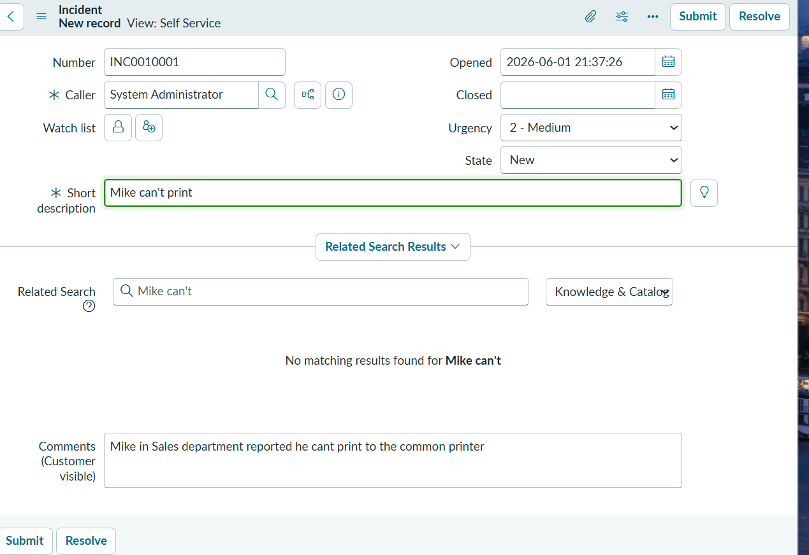
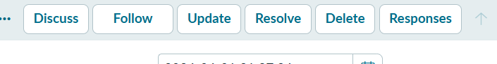
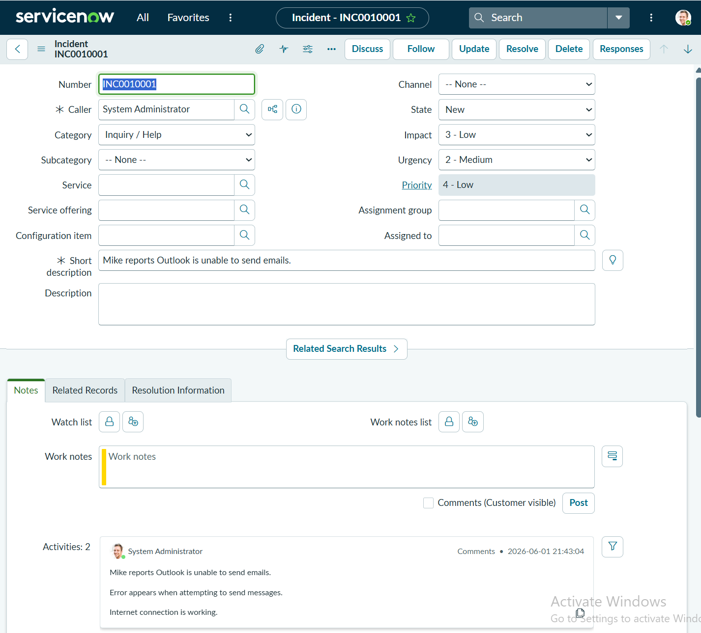
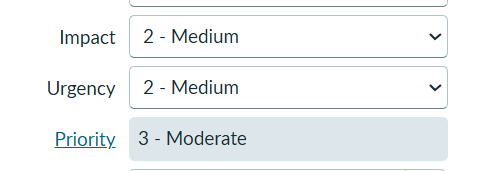

# ServiceNow Ticketing System Notes

## Ticketing System Workflow

A typical ticketing workflow is:

**User reports an issue → Log the ticket → Investigate and troubleshoot → Follow up with the user → Resolve the issue → Close the ticket**

### Example

John calls and says:

> My Outlook is not working.

A ticket may be created as follows:

```text
Ticket #12345
User: John Smith
Issue: Outlook cannot send emails
Priority: Medium
Status: Open
```

## Ticket Lifecycle

A typical ticket lifecycle is:

**New → Assigned → In Progress → Pending → Resolved → Closed**

`Pending` is commonly used when waiting for information or a response from the user.

## Ticket Notes

Ticket notes should document the troubleshooting process, including:

- The user's issue
- Findings
- Actions taken
- Troubleshooting steps
- Relevant timestamps

### Example

```text
09:15 User reports Outlook freezing.
09:20 Checked Task Manager.
09:25 Created a new Outlook profile.
09:35 Issue resolved.
```

## Priority

### P1 – Critical

Examples:

- Company-wide internet outage
- Server outage
- Exchange outage

### P2 – High

Examples:

- Multiple users are affected
- Shared printer failure
- Teams service issue

### P3 – Medium

Examples:

- Single-user Outlook issue
- Single-user OneDrive issue

### P4 – Low

Examples:

- Software installation request
- New user request

## Three Factors to Consider

1. **Impact** – How many people or systems are affected  
   Example: One user cannot access Outlook = **Low impact**

2. **Severity** – The degree of damage or failure  
   Example: A server has completely crashed = **High severity**

3. **Urgency** – How quickly the issue needs to be resolved by the business  
   Example: The director cannot join an important client meeting = **High urgency**

## SLA

**SLA** stands for **Service Level Agreement**. It defines how quickly the support team is expected to respond to the client.

Example response targets:

| Priority | Example response target |
|---|---:|
| P1 | 15 minutes |
| P2 | 1 hour |
| P3 | 4 hours |

## Escalation

Level 1 support handles the most common incidents.

If an issue cannot be resolved at Level 1, it can be escalated to Level 2 or an appropriate specialist team.

Examples include:

- Exchange mail flow
- Firewall issues
- Azure networking

Example escalation notes:

```text
Troubleshooting completed.
Issue appears related to firewall configuration.
Escalated to Level 2.
```

# ServiceNow

In this lab, a support case is handled as an **Incident**.

## Create a New Ticket

Typical process:

**New → Fill in the required fields → Submit → A new ticket is created in the incident list**



## Common Incident Actions



### Discuss

Opens a discussion or collaboration around the ticket. It is generally used to communicate with other IT staff.

### Follow

Follows the ticket so that you can receive updates and track its progress more easily.

This is especially useful when the ticket is not assigned to you but you still want to monitor it, for example as a team leader.

If you created or own the ticket yourself, following it may not be necessary.

### Update

Saves changes made to the ticket.

Examples include changes to:

- State
- Priority
- Work Notes

### Resolve

Marks the ticket as resolved.

Normally, **Resolution** or **Close Notes** should be completed before resolving the incident.

### Delete

Deletes the ticket.

This may be acceptable in a training environment, but tickets generally should not be deleted casually in a production environment.

### Responses

Provides reusable text templates that can be copied and pasted.

## Self-Service View vs Default View

### Self-Service View

The **Self-Service View** is a simplified interface intended for end users.

It focuses on:

- Reporting an issue
- Checking progress
- Adding comments

End users normally cannot see many internal IT fields.

### Default View

The **Default View** is the fuller interface used by IT staff, agents, or administrators.

It includes more operational fields for incident management.



## Impact vs Urgency vs Priority

- **Impact** – How many people or systems are affected
- **Urgency** – How urgently the issue needs to be resolved
- **Priority** – Determined by the combination of Impact and Urgency

In the example used in this lab, Priority is calculated from Impact and Urgency rather than being entered manually.



## Service and Service Offering

### Service

The business or IT service affected by the incident.

Example:

```text
Service: Email
```

### Service Offering

A more specific part of the Service.

Example:

```text
Service Offering: Outlook Desktop Client
```

## Configuration Item (CI)

A **Configuration Item (CI)** is the specific IT asset affected by the incident.

Example:

```text
User's laptop
```

## Work Notes and Additional Comments

### Work Notes

**Work Notes** are internal IT notes used to document troubleshooting, findings, and actions.

### Additional Comments

**Additional Comments** are customer-visible updates.

## Escalating an Incident in ServiceNow

A typical escalation process is:

1. Change the **Assignment Group**.

   Example:

   ```text
   From: Service Desk
   To: Level 2 Support / Network Team / Security Team / Messaging Team
   ```

2. Change **Assigned to** if you know the specific person who should receive the ticket. Otherwise, leave it blank.

3. Add **Work Notes** explaining what you have already checked.

   Example:

   ```text
   User reports Outlook cannot send emails.
   Checked internet connectivity.
   OWA is working.
   Restarted Outlook.
   Issue still persists.
   Escalating to Messaging Team for further investigation.
   ```

4. Click **Update**.
